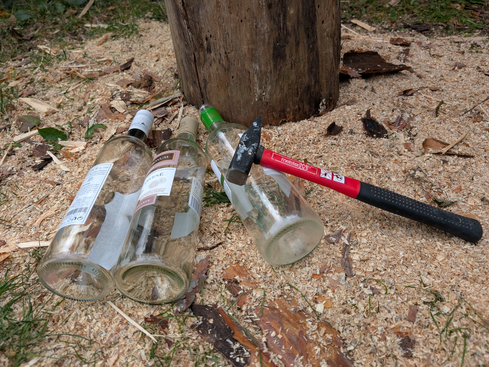
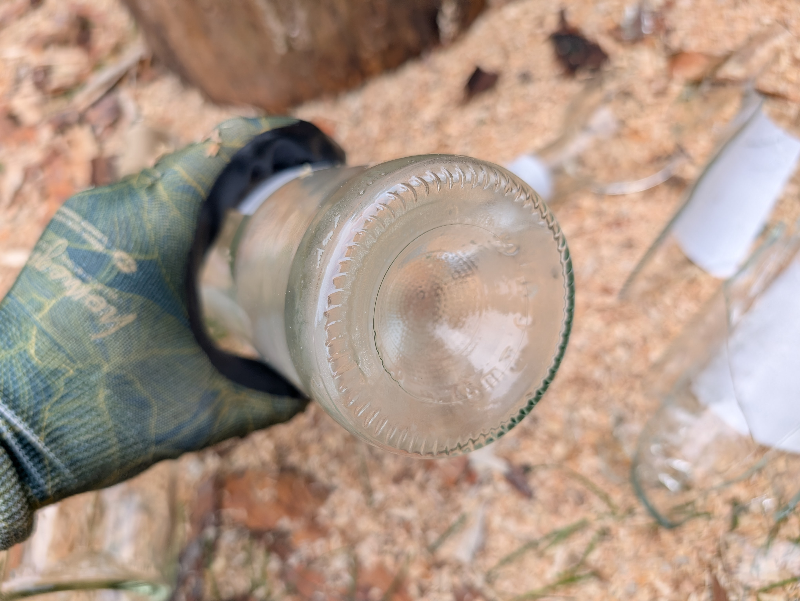

# The Process

I decided to make a letterform from wine glass bottles, they were from a viewing i had with some friends over at my place.

At first, I tried to smash them without much thought, banging them on the sides. It was not very succesful.

I gave it some thought and realized stress concentrates in corners in materials. Bottles break when you throw them in the trash, right?

It was now obvious why bottles have that concave dimple in the bottom.

[Wanna go back?](index.md)
